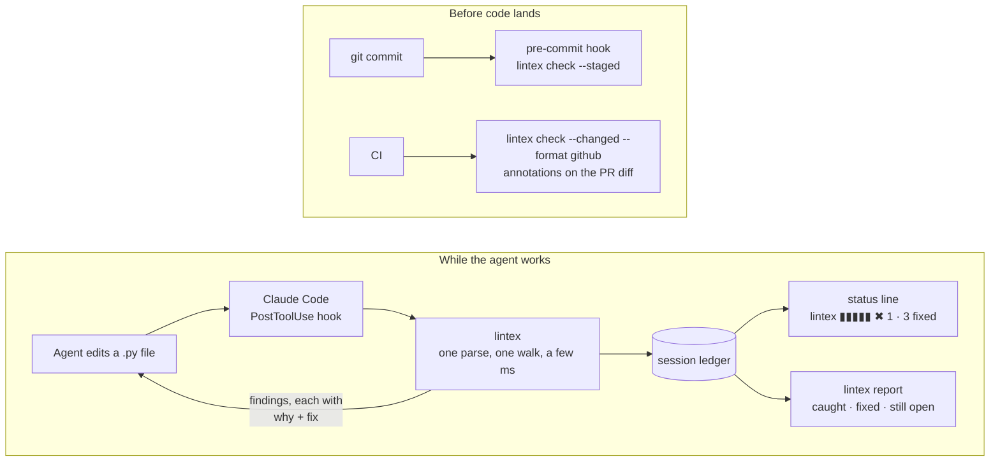

# lintex

**A fast linter for Python written by LLM coding agents.** lintex catches the mistakes agents
actually make, such as hallucinated imports, removed APIs, SQL built with f-strings,
`except Exception: pass`, and `# ... rest of the code unchanged`. It reports each one with an
explanation an agent can act on directly.

```text
app/db.py  2 errors
  7:21    ✖ error   LX201  SQL statement built with an f-string; interpolated values are not escaped.
         7 │ cur.execute(f"SELECT * FROM users WHERE email = '{email}'")
           │             ^^^^^^^^^^^^^^^^^^^^^^^^^^^^^^^^^^^^^^^^^^^^^^
         why Interpolating values into SQL text allows SQL injection whenever any value is
             influenced by user input, and breaks on quotes in ordinary data.
         fix Use bound parameters and pass values separately, e.g. `cur.execute("SELECT * FROM
             users WHERE id = %s", (user_id,))` (placeholder style depends on the driver: `?` for
             sqlite3, `%s` for psycopg/MySQLdb, `:name` with SQLAlchemy `text()`). ...

  13:9    ✖ error   LX401  Placeholder comment '... rest of the implementation unchanged' stands
                           in for code that is not there.
         13 │ # ... rest of the implementation unchanged
            │ ^^^^^^^^^^^^^^^^^^^^^^^^^^^^^^^^^^^^^^^^^^
         why This looks like an elided edit: an LLM summarised existing code with a comment
             instead of reproducing it, so saving the file deletes that code.
         fix Restore the omitted code from the previous version of the file (e.g. `git diff` /
             `git show HEAD:<path>`), then make only the intended change.

✖ Found 2 errors in 1 file  · checked 1 file in 4 ms
  LX201 sql-string-interpolation  ×1
  LX401 placeholder-code          ×1
  Each finding's `fix` line says what to write instead. `lintex explain CODE` has the full story;
  `# lintex: ignore[CODE]` silences a line on purpose.
```

Findings are grouped by file with the exact span underlined. The rationale (`why`) is shown
once per rule so a long report stays readable; pass `-v` to see it every time. Output is coloured
on a terminal and falls back to plain ASCII where Unicode or colour isn't available (`NO_COLOR`
and `FORCE_COLOR` are honoured).

## Where it sits



The hook loop is where lintex earns its keep: the agent sees a finding and its fix in the same
step it made the mistake, so most problems never reach a commit. The commit and CI gates catch
what slips through and show people only the lines they changed.

- **Fast enough for the agent loop.** One `ast.parse` and one tree walk per file, with rules
  dispatched by node type. The cost is close to parsing alone. The CPython stdlib (~300k lines)
  lints in about 3 seconds on a modest machine, and a single edited file takes a few milliseconds.
- **Light.** The only dependency is `tomli`, and only on Python < 3.11. YAML config support is an
  optional extra.
- **Output an agent can act on.** Every finding has a `why` and a `fix`. Use `--json` for harnesses.
- **Hooks included.** `lintex install-hook git` adds a pre-commit hook. `lintex install-hook
  claude-code` sets up a Claude Code `PostToolUse` hook that reports problems back to the model
  right after it edits a file.

## Install

```bash
pip install lintex            # or: uv tool install lintex / pipx install lintex
pip install "lintex[yaml]"    # if you want .lintex.yaml configuration
```

## Usage

```bash
lintex                          # lint the current directory
lintex check src/ app.py        # lint specific paths
lintex check --staged           # lint what is staged in git (the index, not the working tree)
lintex check --changed          # only files changed since the base branch, only changed lines
lintex check --changed=HEAD~3   # ...since a specific ref
lintex check --json             # machine-readable output (same as --format json)
lintex check --format concise   # one `path:line:col: CODE message` per finding, for editors/grep
lintex check --format github    # GitHub Actions annotations, shown inline on the PR diff
lintex check --format full      # every finding with its full why/fix; what the hooks give agents
lintex check -v                 # pretty output with the rationale repeated for every finding
lintex check --select LX1,LX2   # only hallucination + banned-pattern rules
lintex check --fail-on warning  # non-zero exit on warnings too
lintex rules                    # list rules and whether they are enabled
lintex explain LX101            # documentation for one rule
```

Exit status: `0` means clean (or only findings below `fail-on`), `1` means violations, `2` means
a usage or configuration error.

`--changed` is how to adopt lintex on a codebase that already has findings: it compares the
working tree with the merge base of the default branch (`origin/HEAD`, else `main`/`master`),
lints only the Python files that differ, and reports only findings that touch a changed line.
New and untracked files are checked in full. Pass a ref (`--changed=main`, `--changed=HEAD~3`)
to choose the base.

## Rules

| Code | Name | Default | What it catches |
|---|---|---|---|
| LX001 | syntax-error | error | The file does not parse (often a truncated edit) |
| **LX1xx** | **Hallucination guard** | | |
| LX101 | hallucinated-api | error/warn | Removed or renamed APIs: `collections.Mapping`, `distutils`, `numpy.float`, `openai.ChatCompletion`, `pydantic.BaseSettings`, `dict.iteritems()`, `datetime.utcnow()` (warn), ... |
| LX102 | nonexistent-stdlib-name | error | Names that don't exist in a stdlib module (`os.path.joinpath`, `from typing import Json`), with "did you mean" suggestions |
| LX103 | unresolvable-import | *opt-in* | Imports that aren't installed, stdlib, or local modules |
| **LX2xx** | **Banned patterns** | | |
| LX201 | sql-string-interpolation | error | SQL built with f-strings, `.format()`, `%`, or `+` |
| LX202 | raw-sql | *opt-in* | Any raw SQL in `.execute()` / `text()` for ORM-only projects |
| LX203 | dangerous-call | error | `eval`/`exec`, `pickle.loads`, `yaml.load`, `os.system`, `shell=True`, `verify=False` |
| LX204 | insecure-file-operation | error | `tempfile.mktemp`, world-writable modes, tar `extractall()` without `filter=`, hard-coded `/tmp/` paths |
| LX205 | banned-api | error | Project-specific banned modules and functions, with your own message |
| **LX3xx** | **Agent bloat** | | |
| LX301 | function-too-long | warning | More than 50 lines of code (says which blocks to extract) |
| LX302 | high-complexity | warning | Cyclomatic complexity above 10 |
| LX303 | too-many-parameters | warning | More than 7 parameters |
| LX304 | deep-nesting | warning | Blocks nested more than 4 levels deep |
| LX305 | file-too-long | warning | Module with more than 600 lines of code |
| **LX4xx** | **Agent artifacts** | | |
| LX401 | placeholder-code | error | `# ... existing code ...` and other elided edits; `# TODO: implement` (warning) |
| LX402 | swallowed-exception | error | `except Exception: pass` |
| LX403 | bare-except | warning | `except:` |

Hallucination rules skip code inside compatibility guards, such as `try: ... except ImportError`
and `if sys.version_info ...` / `sys.platform` / `hasattr(...)`. LX102 imports only stdlib
modules and never third-party code. It checks against the Python version that runs lintex.

### Where the API knowledge comes from

LX101's list of removed, deprecated and Python-2-only names lives in two data files under
`lintex/knowledge/`, loaded once per run (about a millisecond):

- **`curated.toml`**: hand-written entries with specific fixes (`openai.ChatCompletion`,
  `pydantic.BaseSettings`, `numpy.float`, PEP 594 modules, ...). Adding one is a five-line TOML
  entry with a `fix`; no Python required.
- **`typeshed.json`**: generated from [typeshed](https://github.com/python/typeshed), the type
  stubs mypy and pyright run on. `stdlib/VERSIONS` gives every stdlib module removal, and
  `@deprecated` decorators give deprecated functions and methods with the upstream's own
  message. Regenerate it with `python -m lintex.knowledge.sync --typeshed /path/to/typeshed`
  (or `--from-mypy` for the stdlib part). Curated entries win where both know a name.

Removals are judged against the project's minimum Python: lintex reads `requires-python` from
`pyproject.toml` (or `target-version = "py311"` under `[tool.lintex]`). `import cgi` is an
error when the minimum is 3.13 or later, and a warning ("still exists on your minimum, breaks on
3.13+") before that. Without either, the interpreter running lintex is the target.

### Suppressing

```python
value = eval(expr)  # lintex: ignore[LX203]
value = eval(expr)  # lintex: ignore            (every rule on this line)
# lintex: skip-file                             (anywhere in the file, on its own line)
```

## Configuration

lintex looks for configuration starting in the linted path's directory and moving up, and uses
the first match among `.lintex.yaml`, `.lintex.yml`, `.lintex.toml`, and `pyproject.toml`
(`[tool.lintex]`). Keys can be written in `kebab-case` or `snake_case`.

```toml
[tool.lintex]
exclude = ["migrations", "scripts/legacy/*.py"]   # added to the defaults (.venv, build, ...)
ignore = ["LX305"]
enable = ["LX103", "raw-sql"]                     # turn on opt-in rules
fail-on = "error"                                 # or "warning"
severity = { LX301 = "error" }                    # change a rule's severity
per-file-ignores = { "tests/**" = ["LX203", "LX301"] }

[tool.lintex.rules.function-too-long]
max-lines = 40

[tool.lintex.rules.raw-sql]
hint = "Use the repository classes in app/db/repos.py instead of hand-written SQL."

[tool.lintex.rules.banned-api]
apis = { "requests" = "Use app.http.client (it adds retries, timeouts and tracing).", "print" = "Use `log = structlog.get_logger()`." }

[tool.lintex.rules.unresolvable-import]
known-modules = ["google.colab"]
```

The same settings in `.lintex.yaml`:

```yaml
ignore: [LX305]
enable: [LX103]
rules:
  banned-api:
    apis:
      requests: Use app.http.client.
```

## Hooks

### Claude Code

```bash
lintex install-hook claude-code              # writes .claude/settings.json
lintex install-hook claude-code --scope local   # .claude/settings.local.json (not committed)
```

This adds the following entry, merged with any existing settings:

```json
{"hooks": {"PostToolUse": [{"matcher": "Edit|Write|MultiEdit",
  "hooks": [{"type": "command", "command": "lintex hook claude-code"}]}]}}
```

After each edit, lintex checks the changed file. If it finds problems, it exits with status 2 and
prints them to stderr, and Claude Code passes that output back to the model. Errors in the hook
itself, such as a bad payload or config, never block the agent.

### Session ledger and status line

Every time the Claude Code hook checks an edit, it appends the result to a per-project ledger
(kept in your user cache directory, never in the repo). Two things read it:

**`lintex statusline`** puts a live health strip in Claude Code's status line while the agent
works. One block per checked edit in this session (green clean, yellow warnings, red errors),
then what is still open and how much the agent has already fixed:

```text
Opus · myapp · lintex ▮▮▮▮▮▮▮▮▮▮  ✖ 1 ▲ 2 · 9 fixed
```

```bash
lintex install-hook statusline        # sets statusLine in .claude/settings.json
```

If you already have a status line script, lintex won't replace it; add
`lintex statusline --segment` to that script's output instead.

**`lintex report`** is the ledger itself: what the hook caught, what the agent fixed on its next
edit, and what is still open, per rule.

```text
lintex ledger · myapp · last 24h
lintex ▮▮▮▮▮▮▮▮▮▮ ✖ 1 ▲ 2 · 9 fixed
12 caught across 14 edits of 5 files · 9 fixed by the agent · 3 still open

  LX201 sql-string-interpolation  caught   4  fixed   4  all fixed
  LX402 swallowed-exception       caught   3  fixed   2  1 open
  LX301 function-too-long         caught   2  fixed   0  2 open
  ...

Still open
  ✖ app/db.py:41  LX402 Exception handler catches Exception and silently discards it.
```

`--since 7d`, `--all`, `--session ID`, `--json` and `--clear` are available. Set `ledger = false`
under `[tool.lintex]` to turn recording off, or point `LINTEX_LEDGER_DIR` somewhere else.

### Git pre-commit

```bash
lintex install-hook git        # .git/hooks/pre-commit (honours core.hooksPath)
```

The hook runs `lintex check --staged`, which lints the staged content that will actually be
committed. To use the [pre-commit](https://pre-commit.com) framework instead:

```yaml
repos:
  - repo: https://github.com/700799/lintex
    rev: v0.1.0
    hooks:
      - id: lintex
```

## Recommended setup: lintex + ruff + mypy

lintex only catches known agent mistakes. It does not check that code is correct, well designed
or does what you asked. Pair it with a general linter, a type checker and your tests:

| Layer | Catches | When to run |
|---|---|---|
| **lintex** | Hallucinated APIs, injection and security shortcuts, elided code, silenced errors, bloat | After every agent edit (hook) and at commit |
| **ruff** | Hundreds of general bug and style patterns, unused imports, undefined names | After every agent edit and at commit |
| **mypy** / **pyright** | Wrong argument counts, invented methods on typed objects, `None` misuse | At commit and in CI (too slow for every edit on large projects) |
| **pytest** | Whether the code actually works | At commit and in CI |

### Claude Code hooks

Install both fast checks as `PostToolUse` hooks so the agent fixes cheap mistakes immediately
(`lintex install-hook claude-code` adds the first one). In `.claude/settings.json`:

```json
{
  "hooks": {
    "PostToolUse": [
      {
        "matcher": "Edit|Write|MultiEdit",
        "hooks": [
          {"type": "command", "command": "lintex hook claude-code"},
          {"type": "command", "command": "jq -r '.tool_input.file_path // empty' | grep '\\.py$' | xargs -r ruff check --fix --exit-non-zero-on-fix 1>&2 || exit 2"}
        ]
      }
    ]
  }
}
```

Each hook exits 2 on findings, and Claude Code passes its stderr back to the model. The ruff hook
auto-fixes what it safely can and reports the rest. If `jq` is not installed, use a short Python
script instead of the shell pipeline.

### Pre-commit framework

```yaml
# .pre-commit-config.yaml
repos:
  - repo: https://github.com/astral-sh/ruff-pre-commit
    rev: v0.8.0
    hooks:
      - id: ruff
        args: [--fix]
      - id: ruff-format
  - repo: https://github.com/700799/lintex
    rev: v0.1.0
    hooks:
      - id: lintex
  - repo: https://github.com/pre-commit/mirrors-mypy
    rev: v1.13.0
    hooks:
      - id: mypy
```

Then `pip install pre-commit && pre-commit install`. Pin `rev` values to the versions you actually
want; the ones above are examples.

### Agent instructions

Add this to your `CLAUDE.md` (or equivalent) so the agent knows the checks exist and how to react:

```markdown
## Code quality
- `lintex check <file>` and `ruff check <file>` run automatically after each edit.
  Fix every reported issue as its `fix:` line says before moving on.
- Never suppress a finding (`# lintex: ignore`, `# noqa`) to make it go away;
  suppress only when the code is deliberately an exception, and say why in the comment.
- Run `mypy src` and `pytest` before declaring a task done.
```

## Library API

```python
from lintex import Linter, lint_source, load_config

violations = lint_source(code, path="generated.py")
for v in violations:
    print(v.code, v.line, v.message, v.fix)

linter = Linter(load_config("."))       # reuse for many files
result = linter.lint_paths(["src"])
result.to_dict()                        # same shape as --json
```

## Development

```bash
uv venv && uv pip install -e . pytest pyyaml ruff
pytest
ruff check src tests && ruff format --check src tests
lintex check .                          # lintex lints itself
```

A new rule subclasses `lintex.rules.base.Rule`. It sets `code`, `name`, `summary`, and
`node_types`, implements `check_node` and/or `check_file`, and is added to `ALL_RULES` in
`lintex/rules/__init__.py`.

## License

MIT
